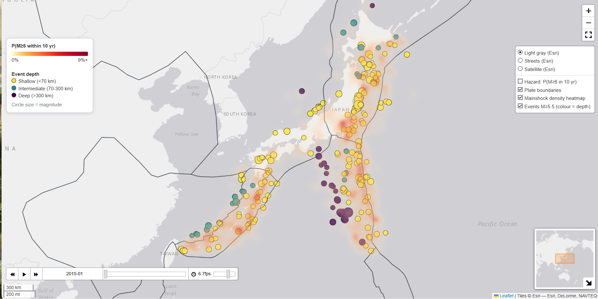
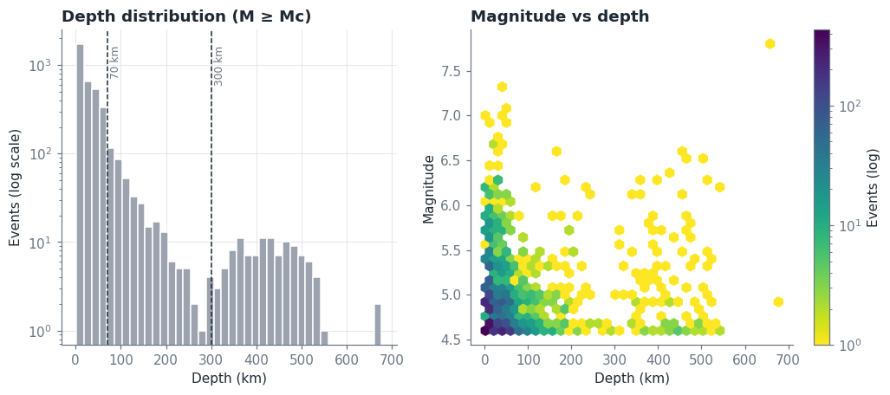
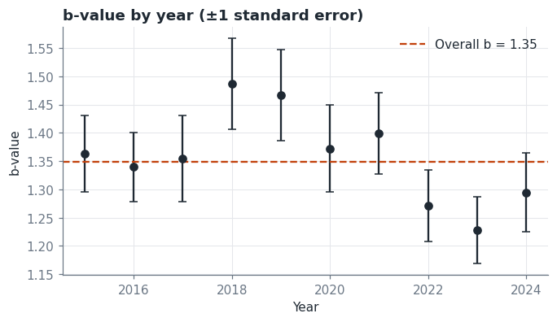
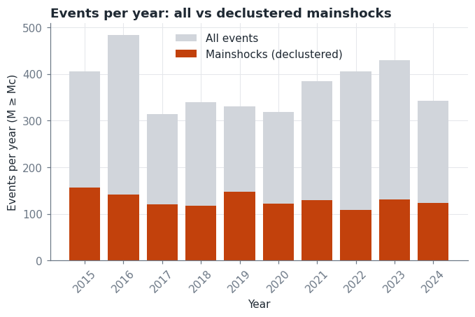
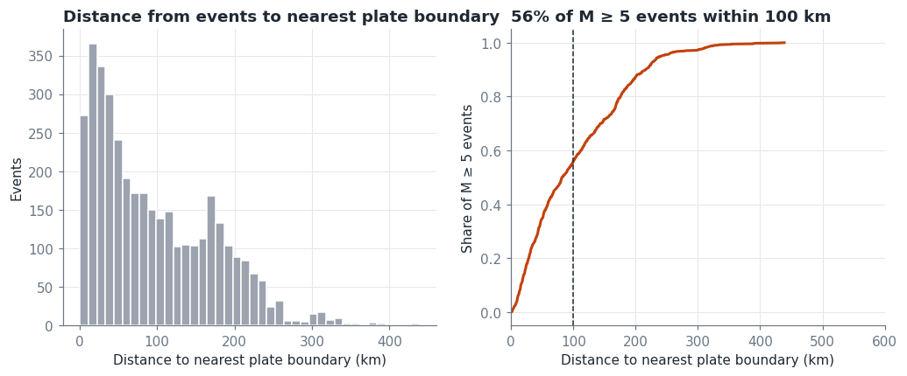
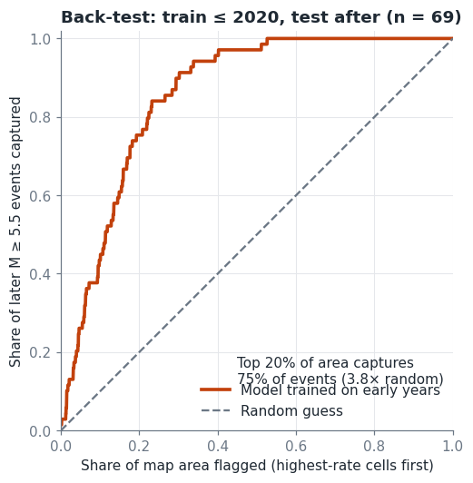

**[](https://kananugik.github.io/japan-earthquake-hazard-screening/outputs/earthquake_risk_map.html)** · **[](https://kananugik.github.io/japan-earthquake-hazard-screening/outputs/earthquake_scenario_map.html)**
# Japan Earthquake Hazard Screening

A reproducible analysis of an earthquake catalog for Japan. The notebook explores earthquake magnitudes, depths, plate-boundary proximity, and spatial patterns, then builds a simplified map ranking areas by relative earthquake activity.

This is a **screening and research project**, not an operational earthquake forecast. It does not predict the time or exact location of an earthquake or estimate damage to people or buildings.

## Results discussed

The figures below are from the analysis run discussed alongside this project. They are catalog- and run-specific: changing the catalog, analysis period, or settings may change them. Rerun the notebook to regenerate results for the data currently in `data/earthquakes.csv`from 2017 to early 2025 for the country of Japan.

## Figures

### Depth distribution and magnitude versus depth


### Annual b-value stability


### Annual events: all events versus mainshocks


### Distance to plate boundaries


### Back-test


### Interactive hazard map (catalog-based)

Open [`outputs/earthquake_risk_map.html`](outputs/earthquake_risk_map.html) in a browser to explore the modeled probability grid alongside plate boundaries and larger observed earthquakes. Marker color represents depth and size represents magnitude; the optional density heatmap is off by default. The time slider animates larger catalog events (approximately M ≥ 5), showing their recorded timing and locations—not a forecast of future events.

### Magnitude recurrence and 10-year scenario
One simulated 10-year scenario produced **1,280 mainshocks of M ≥ 4.6**, including **41 of M ≥ 6** and **2 of M ≥ 7**. These are counts from a single stochastic simulation, so they can differ from the long-term averages and are not predictions of what will actually occur. The scenario map is saved as `outputs/earthquake_scenario_map.html`; open it in a browser and use its time slider to explore the simulated sequence.

| Analysis | Result | How to read it |
|---|---:|---|
| Regional catalog summary | 10,460 Japan events; maximum magnitude 7.8 | Describes the full dataset used for that summary. |
| Magnitude of completeness | Mc = 4.6 | The analysis uses events at or above this estimated threshold, where the catalog is assumed to record events more consistently. It is not a guarantee that every such earthquake was recorded. |
| Gutenberg–Richter fit, all events ≥ Mc | b = 1.348 | The fitted number of earthquakes drops by a factor of about 22 for each whole-magnitude increase (10^1.348), under the fitted relationship. |
| Declustered catalog | 1,300 of 3,753 events at or above Mc retained as mainshocks; 65% flagged as dependent | The declustering method identifies likely aftershocks/dependent events using space-time windows. These labels are estimates, not definitive classifications. |
| Gutenberg–Richter fit, mainshocks | b = 1.066 ± 0.030 | After declustering, the fitted magnitude-frequency curve is less steep, corresponding to relatively more large events than in the all-events fit. ±0.030 is the reported standard error, not total uncertainty. |
| M ≥ 6 count check | 41.8 expected; 56 observed over the catalog period | The simplified model's estimated total is below the observed count. This is a diagnostic comparison, not a future count prediction or, by itself, a statistical significance test. |
| Plate-boundary proximity | 56% of M ≥ 5 events within 100 km | A small majority of these events are near the mapped plate boundaries. The 100 km threshold is a convenient benchmark, not a sharp geological boundary. |
| Out-of-sample back-test | Training through 2020; top 20% of area captured 75% of 69 later M ≥ 5.5 mainshocks (3.8× the 20% random-area benchmark) | The high-ranked cells contained many later events in this test. This evaluates spatial ranking for this catalog and test period; it does not show that the model can predict event timing. |
|Frequency of future simulated events of each size| The model estimates an M ≥ 6 event about every 0.2 years (roughly 50 per 10 years), an M ≥ 7 about every 2.8 years, and an M ≥ 8 about every 32.4 years. Under the model's Poisson assumption, the corresponding chance of at least one event in 10 years is approximately 100%, 97%, and 27%, respectively. One simulated 10-year scenario produced 1,280 mainshocks of M ≥ 4.6, including 41 of M ≥ 6 and 2 of M ≥ 7.  |

### Interpreting the diagnostic plots

- **Depth distribution and magnitude versus depth:** Most catalog events are shallow, with a smaller group at intermediate and greater depths. The plot uses events with magnitude at least Mc; its dashed depth markers are at 70 km and 300 km. A concentration of deep events is geologically plausible in a subduction setting, but the plot alone does not establish the cause.
- **Year-by-year b-value stability:** Annual estimates vary around the overall b-value (about 1.35 in the discussed run). The values rise in some years and fall in later years, but uncertainty bars overlap the overall estimate in many years. This suggests variation worth checking, not proof of a lasting change in earthquake behavior.
- **Events per year, all versus mainshocks:** Mainshocks are a smaller subset of all events in each year. Since declustering changes the estimated b-value, how aftershocks are handled affects the magnitude-frequency analysis.
- **Distance to plate boundaries:** The distances are great-circle (geodesic) distances to the PB2002 plate-boundary model. The histogram and cumulative curve show that events cluster closer to mapped boundaries, though many are more than 100 km away.
- **Back-test curve:** The orange curve shows the share of later events captured as more of the highest-ranked area is included. The diagonal represents the simple benchmark where events are distributed in proportion to area. The model curve being above it indicates useful spatial concentration in this particular test.
- **Magnitude recurrence plot and scenario:** The curve translates the fitted magnitude-frequency relationship into estimated average recurrence intervals for the whole study area. Recurrence intervals are averages, not schedules: an event that averages once every 2.8 years is not guaranteed to happen on that timetable. The 10-year probabilities and simulated counts depend on the Gutenberg–Richter and Poisson assumptions.
The recurrence plot summarizes the model's estimated frequency of earthquakes across the 
- **Frequency of future simulated events of each size**. The vertical axis is the average modeled time between events at or above each magnitude threshold, shown on a logarithmic scale. The orange line is the Gutenberg–Richter extrapolation; black dots show observed catalog recurrence estimates where there were at least three events. The dashed horizontal line marks the 10-year scenario horizon.These are counts from a single stochastic simulation, so they can differ from the long-term averages and are not predictions of what will actually occur. The scenario map is saved as `outputs/earthquake_scenario_map.html`; open it in a browser and use its time slider to explore the simulated sequence. These are model-based probabilities for the study area as a whole, not forecasts of dates or locations.


## What the numbers do not say

- **Mc is an estimated data-completeness cutoff.** Events below it may be under-recorded; even above it, completeness can vary by location and time.
- **The b-value describes a frequency relationship, not an earthquake schedule.** The standard error captures only statistical uncertainty under the fitting method, not uncertainties in the catalog, assumptions, or model.
- **“Expected 41.8, observed 56” is a model check.** It compares a model-derived expected total against the catalog's observed total over the same period. It does not mean 41.8 or 56 events are expected in the next period.
- **“3.8× random” uses a simple area benchmark.** It compares 75% captured in the top 20% of the map with 20% expected under uniform area-based guessing. It is not a probability multiplier for future earthquakes.
- **The scenario map is simulated, not observed.** The 1,280, 41, and 2 event counts describe one generated 10-year realization from the model. Other simulations can produce different counts, and the map does not predict actual event times or locations.
- **Plate proximity is descriptive.** The project does not test against a spatial null model that accounts for the catalog's geographic coverage.
- **Relative seismic activity is not societal risk.** The map does not model shaking, soil/site effects, building vulnerability, population exposure, or potential losses.

## Analysis workflow

1. Clean the USGS catalog: remove invalid or duplicate records and report cleaning steps.
2. Estimate the magnitude of completeness (Mc) using the maximum-curvature method with a +0.2 correction.
3. Fit the Gutenberg–Richter b-value using the Aki–Utsu maximum-likelihood method with a magnitude-bin correction; inspect annual stability.
4. Flag likely mainshocks with Gardner–Knopoff space-time windows to reduce aftershock clustering.
5. Build a gridded relative hazard screen by smoothing mainshock counts, converting them to annual rates, extrapolating to a target magnitude with the Gutenberg–Richter relationship, and applying a Poisson probability model.
6. Compare event locations with the PB2002 plate-boundary model using geodesic distances.
7. Back-test the spatial ranking by training on earlier years and evaluating where later earthquakes occurred.

The hazard screen uses a simplified Poisson assumption and Gutenberg–Richter extrapolation. It is **not a full probabilistic seismic hazard analysis (PSHA)**: it has no ground-motion model, site effects, or fault-specific recurrence model.

## Project structure

```text
earthquake_risk_analysis.ipynb   Narrated analysis and visualizations
src/japan_quake_risk/                  Reusable code for data, statistics, hazard, tectonics, and visualization
tests/test_stats.py              Unit tests for statistical functions
tests/make_synthetic.py          Synthetic data used for code smoke tests, not real earthquake results
data/                            Earthquake CSV input and plate-boundary data
outputs/                         Generated tables, figures, GeoJSON, and interactive map
```

## Run the analysis

Install dependencies:

```bash
pip install -r requirements.txt
```

Place a USGS ComCat CSV export at `data/earthquakes.csv`, then run the narrated notebook:

```bash
jupyter notebook earthquake_risk_analysis.ipynb
```

Or run the command-line pipeline:

```bash
PYTHONPATH=src python -m quake_risk.pipeline data/earthquakes.csv
```

Run tests:

```bash
pytest tests
```

The interactive hazard map, when generated, is `outputs/earthquake_risk_map.html`. It includes the hazard grid, plate boundaries, event locations, and additional context layers. The simulated scenario is shown separately in `outputs/earthquake_scenario_map.html`; use its time slider to view the generated sequence.

## Recommendations

This is a transparent, catalog-based *screening* tool that ranks areas by relative earthquake activity.It is not a full probabilistic seismic hazard assessment (PSHA). Known limitations:
- **Short record.** A decade of data cannot capture the recurrence of the largest events (hundreds to thousands of years). The M ≥ 6 numbers rely on extrapolating the  Gutenberg-Richter line.
- **Simulation is illustrative.** The scenario map is one random draw; it contains no aftershocks and says nothing about which specific event happens when.
- **Extrapolation to the largest events.** Return periods for M 7.5+ extend the fitted line beyond what a short catalog contains; treat them as rough.
- **Poisson assumption.** Declustering helps, but large earthquakes are not perfectly memoryless; fault-specific recurrence models would do better.
- **No ground motion or site effects.** Damage depends on shaking intensity, soil amplification and building stock, none of which are modelled here.
- **Cell size and smoothing** are judgement calls. Try `CELL_DEG` and `SIGMA_CELLS` variations to see how sensitive the map is.
- **Completeness may vary** by region and over time.

**Possible extensions:** overlay population or infrastructure for *risk* (hazard × exposure); use fault databases; compare against published national hazard maps; add a Bayesian or bootstrap uncertainty band on the probabilities.

**Data:** USGS ComCat earthquake catalog. **Plate boundaries:** Bird (2003) PB2002 via the `fraxen/tectonicplates` repository.

## Data and references  

- Earthquake catalog: [USGS ComCat Search](https://earthquake.usgs.gov/earthquakes/search/). Required CSV columns: `time`, `latitude`, `longitude`, `depth`, and `mag`.
- Plate boundaries: Bird, P. (2003), “An updated digital model of plate boundaries,” *Geochemistry, Geophysics, Geosystems*, distributed in this project as `data/plate_boundaries.json`.
- Methods: Gutenberg & Richter (1944); Aki (1965); Utsu (1965); Gardner & Knopoff (1974); Woessner & Wiemer (2005).
